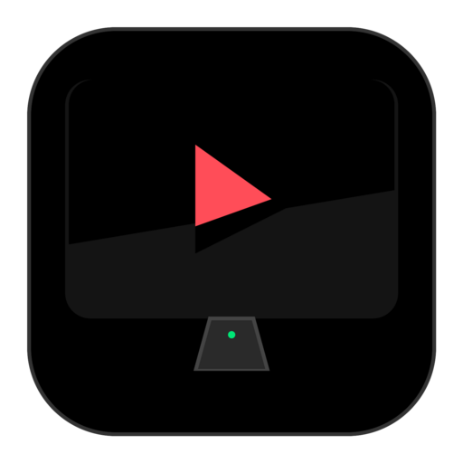

# FlixDesk 🎬

<div align="center">
  
  <h1>FlixDesk</h1>
  <p><strong>Modern, Standalone Netflix Desktop Client for Linux</strong></p>
  <p>Seamlessly integrated with Pop!_OS COSMIC, GNOME, KDE Plasma, and modern Wayland/X11 desktops.</p>
</div>

---

## 🌟 Key Features

- **🌐 Multi-Browser & Standalone Execution:** Run directly with your favorite browser engine (**Brave**, **Google Chrome**, **Mozilla Firefox**, **Chromium**, **Microsoft Edge**, **Vivaldi**) or run the native Python Qt desktop client.
- **🛡️ 100% Working Widevine DRM Playback:** Automatic discovery and linking of Google Widevine CDM across system and browser installations.
- **🐧 Native Linux MPRIS D-Bus Integration:** Control playback using your physical keyboard media keys (<kbd>Play</kbd>/<kbd>Pause</kbd>/<kbd>Next</kbd>), GNOME top bar quick settings, COSMIC media applet, KDE Plasma audio widget, and lock screen controls.
- **⚡ 1080p Full HD Stream Unlock:** Automatically overrides Linux 720p browser limits to deliver crisp 1080p high-bitrate video streams.
- **⏭️ Smart Auto-Skip:** Intelligently detects and clicks *"Skip Intro"*, *"Skip Recap"*, and advances to the *"Next Episode"*.
- **🔔 System Tray Integration:** Minimize to your desktop panel with quick playback actions (Play/Pause, Next Episode, Preferences, Quit).
- **🚀 Hardware Video Acceleration:** Pre-configured with VA-API flags and GPU rasterization for smooth 60fps playback with low CPU/battery consumption.
- **🖥️ Desktop Shortcut Installer:** One-command installer to add FlixDesk directly into your Linux application menu and dock.

---

## 🚀 Running FlixDesk (Choose Your Mode)

FlixDesk offers two flexible execution modes. Choose whichever works best for your workflow:

### Mode 1: Universal Browser App Mode (Fastest & Zero Setup)

Launch Netflix in a clean, dedicated, borderless desktop window powered by your existing web browser. No large packages or compiler dependencies required!

#### 1. Auto-Detect Any Installed Browser
```bash
# Clone the repository
git clone https://github.com/Pak-Man926/FlixDesk.git
cd FlixDesk

# Launch immediately with best available browser
./run_browser.sh
```

#### 2. Select a Specific Browser
You can force FlixDesk to run with any installed browser using `--browser` (or `-b`):

```bash
# Launch with Brave Browser
./run_browser.sh --browser brave

# Launch with Google Chrome
./run_browser.sh --browser chrome

# Launch with Mozilla Firefox
./run_browser.sh --browser firefox

# Launch with Chromium
./run_browser.sh --browser chromium

# Launch with Microsoft Edge
./run_browser.sh --browser edge

# Launch with Vivaldi
./run_browser.sh --browser vivaldi
```

> [!TIP]
> **Check available browsers on your system:**
> ```bash
> ./run_browser.sh --list
> ```

#### Browser Notes & Widevine DRM:
* **Brave Browser:** If you see Netflix error `M7701-1003` on first launch, open Brave and navigate to `brave://settings/extensions`, then toggle **Widevine** to **ON**.
* **Mozilla Firefox:** Runs in a dedicated FlixDesk profile with DRM (`media.eme.enabled`) and Widevine automatically configured.
* **Google Chrome & Chromium:** Automatically uses hardware video acceleration (VA-API) and connects to system Widevine CDM.

---

### Mode 2: Native Desktop Client (Python + QtWebEngine + MPRIS)

The native desktop client runs a dedicated Qt container featuring native Linux MPRIS media key integration, system tray minimization, custom keyboard shortcuts, and injected scripts (1080p unlock & auto-skip).

#### 1. Install Dependencies
```bash
# Install required Python packages
pip3 install -r requirements.txt
```
*(On Debian/Ubuntu/Pop!_OS: `sudo apt install python3-pyside6` or `pip3 install PySide6 --break-system-packages`)*

#### 2. Launch Native Client
```bash
./run.sh
# or explicitly force native mode:
./run.sh --native
```

> [!NOTE]
> If `PySide6` is not installed on your system when running `./run.sh`, FlixDesk will automatically attempt to install it or gracefully fall back to **Universal Browser App Mode** so your playback is never blocked.

---

## 🖥️ Install Desktop Shortcut (Application Menu & Dock)

To integrate FlixDesk into your Linux desktop launcher (GNOME Dash, KDE Kickoff, COSMIC Applications, etc.) and system dock:

```bash
./install-desktop.sh
```

This will:
- Register `flixdesk.desktop` into `~/.local/share/applications/`
- Install high-resolution application icons into `~/.local/share/icons/`
- Provide desktop actions for both **Browser Mode** and **Native Client Mode** directly from your right-click context menu.

---

## 🛡️ Standalone Widevine DRM Setup (Optional)

If your Linux distribution does not have a browser with Widevine pre-installed, you can run the standalone extractor utility:

```bash
./packaging/scripts/extract-widevine.sh
```
This utility auto-detects Widevine from any installed browser (Brave, Chrome, Chromium, Edge, Vivaldi) or downloads the official library into `~/.config/FlixDesk/WidevineCdm`.

---

## ⌨️ Keyboard Shortcuts (Native Mode)

| Shortcut | Action |
| :--- | :--- |
| <kbd>Space</kbd> | Play / Pause video |
| <kbd>F11</kbd> | Toggle Fullscreen Mode |
| <kbd>Ctrl</kbd> + <kbd>,</kbd> | Open Preferences Dialog |
| <kbd>Ctrl</kbd> + <kbd>R</kbd> / <kbd>F5</kbd> | Reload Netflix Page |
| <kbd>Left Arrow</kbd> | Seek Backward 10 seconds |
| <kbd>Right Arrow</kbd> | Seek Forward 10 seconds |
| <kbd>Ctrl</kbd> + <kbd>Q</kbd> | Quit FlixDesk |

---

## 🏗️ Project Architecture

```text
FlixDesk/
├── flixdesk/
│   ├── __init__.py
│   ├── main.py               # Application bootstrap & Qt initialization
│   ├── window.py             # Main QWebEngineView window with shortcuts & state
│   ├── widevine.py           # Multi-browser & dynamic glob Widevine CDM locator
│   ├── mpris.py              # Linux MPRIS D-Bus provider (org.mpris.MediaPlayer2)
│   ├── tray.py               # Qt System Tray controller
│   ├── settings.py           # Persistent configuration manager
│   ├── preferences_dialog.py # Dark-themed Preferences modal
│   └── scripts/
│       ├── auto_skip.js      # Injected auto-skip intro/recap script
│       ├── force_1080p.js    # Injected 1080p stream unlocker
│       └── player_sync.js    # Injected player state extractor
├── assets/
│   ├── icons/                # Multi-resolution PNGs (16-512px) & SVG icon
│   └── flixdesk.desktop      # Standalone Linux desktop entry
├── packaging/
│   └── scripts/
│       ├── build.sh          # Build & packaging overview script
│       └── extract-widevine.sh # Multi-browser Widevine installer utility
├── requirements.txt          # Python dependencies
├── run.sh                    # Dual-mode launcher (Native Qt / Browser fallback)
├── run_browser.sh            # Universal multi-browser standalone launcher
├── run_chrome.sh             # Backward-compatible Chrome launcher wrapper
├── install-desktop.sh        # Desktop shortcut & icon installer
├── electron-builder.json     # Optional AppImage/deb packaging config
└── README.md
```

---

## ⚖️ Legal Disclaimer

**FlixDesk** is an open-source unofficial desktop wrapper for `netflix.com` and is **NOT** affiliated with, endorsed by, or sponsored by Netflix, Inc.

Netflix and all associated trademarks, logos, and brand elements are the intellectual property of Netflix, Inc. This project does not distribute copyrighted media streams, proprietary keys, or circumvention tools.
